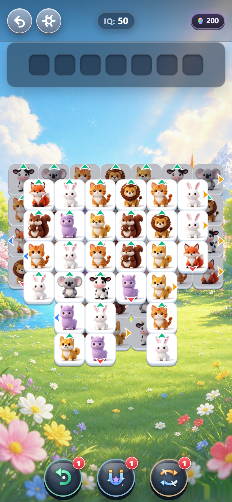
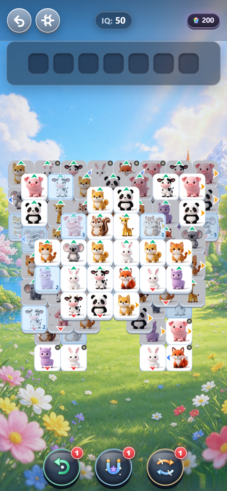
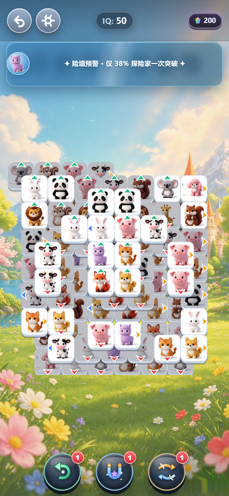

# Glide Critters · 萌灵飞滑

> **奇幻自然探险风的「顺向飞滑」三消益智游戏** —— 卡牌只肯朝它箭头指的方向飞；凑够三张同族萌灵，它们才会在待消槽里合体消散。
>
> 72 关 · 6 幅画卷 · 96 种 3D 萌宠 · 零框架零依赖 · 双击即玩 · 100% 机判可解

---

## 🎮 在线试玩（Live Demo）

| 入口 | 地址 | 说明 |
|---|---|---|
| **主域名（推荐）** | **https://slide-triple-match.pages.dev** | Cloudflare Pages 生产域名，始终指向最新构建 |
| 版本快照 | https://283b2c1b.slide-triple-match.pages.dev | 固定部署 ID，用于作品存档与复现 |

> 📱 **手机体验更佳**：用手机浏览器打开上述链接 → 分享菜单 → **「添加到主屏幕」**。
> 页面已声明 `apple-mobile-web-app-capable` / `mobile-web-app-capable` 与 `black-translucent` 状态栏，
> 从主屏幕启动即进入**无地址栏、无浏览器 UI 的全屏 App 模式**，配合 `viewport-fit=cover` 与安全区让位，
> 顶部刘海与底部手势条都不会压住 HUD 与道具栏。

---

## 📸 实机画面（Screenshots Gallery）

> 全部为 390 × 844 移动端视口、`devicePixelRatio = 2` 的无头浏览器实机截图（输出 780 × 1688），
> 由 `node tools/showcase-shots.js` 一键复现。

| 主大厅 · 画卷相框 | 顺向飞滑棋盘 |
|:--:|:--:|
|  |  |
| **主大厅**：双行立体标题、探险家头像、四格画卷相框（充能解锁）、底部「关卡 N」主按钮 | **标准对局（L3）**：3D 萌宠卡牌 + 四向箭头、奇偶层半格交错的多层堆叠、顶部 7 格待消槽 |
|  |  |
| **特殊机关与道具（L12）**：8×8 / 102 牌的冰蓝霜纹 + 裂纹层数 + 厚度数字的**冰封滑块**、右上角齿轮标记，底部撤回 / 磁吸 / 洗牌三大道具 | **高难预警与连击反馈（L6 峰值关）**：待消区上方的**流光预警横幅**（六画卷自适应色相）+ 搭档头像探头构图 |

---

## 🧩 核心玩法与特殊机关全览

### 1. 顺向飞滑（Slide & Triple）核心循环

| 规则 | 机制说明 |
|---|---|
| **方向指示** | 每张卡牌带 `U / R / D / L` 四向之一（三角翼徽），只能沿**箭头所指方向**飞出 |
| **飞出前置** | ① 不被上层「压角」锁定；② 自身是所在格栈顶；③ 沿箭头射线到棋盘边缘**同层无任何阻挡** |
| **凌空飞越** | 射线按层高判定：高层卡牌可从低层卡牌头顶飞过（`z_target < z_self` 不阻挡） |
| **入槽** | 飞出的卡牌进入顶部 **7 格待消槽**；凑齐 **3 张同花色**立即磁吸合体消除并计分 |
| **受阻反馈** | 被阻挡时**原地微震 + 清脆双叩**（白瓷/竹木物理碰撞音），连击清零，**不扣生命** |
| **失败条件** | 待消槽 **7 格爆满**（`lost_burst`）或棋盘陷入**无解死局**（`lost_deadlock`） |

> 设计取舍：这不是「点一下消一张」的消消乐，而是**先读朝向、再拆封锁**的路径规划。
> 一次点击可能同时解开三张牌的路线——爽感来自「拆锁」而不是「连点」。

### 2. 特殊障碍与机关机制

| 机关 | 源码标记 | 行为 |
|---|---|---|
| **冰封滑块 Frozen Tiles** | `m:"i"` + `x` 层数（1~3） | 冰层包裹时**完全不可点击**；每完成一次三消，**全场所有冰封各裂一层**（`iceMode:"triple"` 主口径；引擎另备 `adjacent` 变体：仅与消除牌十字相邻的冰封裂一层）；层数归零即解冻为普通卡牌。视觉上为冰蓝霜面 + 白色裂纹线 + 右下角厚度数字 |
| **齿轮滑块** | `m:"g"` | 十字相邻（同层）的卡牌成功飞出时，齿轮**顺时针旋转 90°**（`d=(d+1)%4`），是打通「方向对冲」的关键 |
| **锁链滑块** | `m:"c"` | 被锁死不可点击，需对应的**钥匙滑块**（`m:"k"`）飞出后解锁（`cfg.chains` 配对，支持一钥多锁） |
| **棱镜** | `prisms:[{r,c,t}]` | `/` 与 `\` 两种折射面，贯穿全层高；射线撞上即按反射表转向续走（8 条枚举映射），可构造折线长路径 |
| **多层立体堆叠** | `z: 0~4`（最多 5 层） | 奇偶层**半格错位**（奇数层 `+0.5`）；被上层「压角」即锁定不可点；零悬空铁律保证上层必有支撑 |
| **方向对冲 / 死局自愈** | `healHeadOnCollisions` | 两张牌互指对方形成闭环时，判定为潜在死局并**自动旋转一张牌**脱困（不删牌、不降难度） |
| **峰值关流光预警** | `STM.PeakBanner` | 每幅画卷的**第 6 / 12 关**（共 12 关）在待消区上方浮出 1.4s 流光横幅：「✦ 险境预警 · 仅 N% 探险家一次突破 ✦」，色相随六画卷自适应 |

### 3. 局内辅助道具与复活系统

| 道具 | 图标语义 | 效果 | 每关次数 |
|---|---|---|:--:|
| **撤回 Undo** | 回旋箭头 | 回退上一步操作（含磁吸 / 洗牌等道具动作），棋盘与待消槽逐字段还原 | 1 |
| **磁吸消除 Magnet** | U 型磁铁 + 星芒 | 以槽内花色为准，从棋盘**自动吸 1~3 张同花色**补足一组并立即三消；逐张试算保证不破坏零悬空 | 1 |
| **重排洗牌 Shuffle** | 双弧箭头 | 全场未消除卡牌**重排花色与朝向**（位置与层号不变），按拓扑可达序重赋安全方向，确定性种子可复现 | 1 |

**棱晶复活（Revive）**：待消槽 7 格爆满时弹出复活页 —— 消耗 **100 棱晶**执行「净化消除」：
成组清空槽内卡牌（恒为 3 的倍数，花色守恒）、**腾空待消槽**、恢复生命并**续局不重置棋盘**，
复活后剩余卡牌仍保持 100% 可解。

### 4. 外围成长与智能演示

| 系统 | 规则 |
|---|---|
| **六大画卷（72 关）** | 晨曦雪峰庄园 → 云端飞瀑风车岛 → 碧浪椰影浅湾 → 凛冬冰川镜湖 → 云端霞彩航道 → 星穹极光之巅，每幅 12 关 |
| **画卷碎片充能** | 每幅 4 块晶片，**每第 3 关（3/6/9/12）首通点亮一块**；4/4 满充能额外奖励 **+150 棱晶** |
| **棱晶货币** | 初始 200；首通普通关 **+25**、困难位关 **+60**、重复通关 **+10**；复活 **−100**（余额恒 ≥ 0） |
| **动态 IQ 评估** | 局内从 **50** 起算，每次三消按「连击 × 失误惩罚 × 用时衰减」增益，上限 **200**，五档称号：敏锐直觉 → 逻辑达人 → 超凡头脑 → 最强大脑 → 旷世奇才 |
| **探险家伙伴** | 大厅左下角切换搭档，头像贯穿大厅 / 预警横幅 / 结算页，同一套缓存链渲染 |
| **自动演示 Auto-Play** | 内置**回溯求解器**：每步枚举所有可飞出牌做深度搜索；待消槽 ≥ 5 时优先用磁吸保命；残局亦可必胜，用于评委一键看完全流程 |

---

## ⚙️ 技术架构与工程亮点

| 亮点 | 实现要点 |
|---|---|
| **60 / 120 FPS 渲染管线** | 零第三方框架、零构建链、零 npm 运行时依赖；原生 JavaScript（UMD 双导出，浏览器挂 `window.STM`、Node 可直接 `require`）+ Canvas 2D 单画布 |
| **全盘单轨渲染** | 每帧按 `(z, r, c)` **拓扑升序**一次性重绘，从根上消灭多层堆叠的穿模闪烁；不做分层画布叠加 |
| **零 `shadowBlur` 预烘焙** | 全部立体投影 / 高光 / 磨砂托盘在**离屏画布**预烘焙为贴图，主循环只做 `drawImage`，避免每帧高斯模糊 |
| **96 种 3D 图标归一化** | 6 张大图集 × 16 格 = 96 种动物；离线脚本按**连通域 + 色彩阈值**扫描每格真实包围盒，输出 `icon-bboxes.js`，实现 100% 居中等大显示 |
| **100% 可解性保障** | 逆向构造生成器 + 自研回溯求解器（`tools/solver.js`）双端复用同一套 `RulesEngine`；全量 **72/72 可解**、零悬空违规、222 个卡点全部通过 |
| **混合双轨声学** | ① `HTMLAudioElement` **8 轨原声池**（2 BGM + 6 音效，`file://` 与线上部署均可用，禁用 `fetch+decodeAudioData` 规避 CORS）；② Web Audio **实时物理包络合成**（提牌 / 落槽 / 双叩 / 落牌涟漪） |
| **连击声学** | **5 秒滑动时间窗**内连续三消升调（`playbackRate` 1.00 → 1.30，步长 0.05），并按档位触发 `good / great / unbelievable` 人声夸赞 |
| **纯力学动效** | 开局**原位对角波浪层叠**进场（`delay=(r+c)×step + z×step`，恒 360~420ms）；三消为**真实卡牌四段演出**（冲刺 → 挤压闪白 → 回弹 → 坍缩 + 托盘微震），零绘制型粒子特技 |

**门禁基线（本地离线可复跑）**

| 命令 | 结果 |
|---|---|
| `node tools/solver.js` | **72 / 72 solvable** |
| `node tools/render-selftest.js` | **349 项断言全绿** |
| `node tools/deal-smoke.js` | **63 项断言全绿** |
| `node tools/audio-smoke.js` | **98 项断言全绿** |
| `node tools/showcase-shots.js` | 4 张实机截图 + 包围盒取证 |

---

## 🚀 快速启动与项目结构

### 三种打开方式

| 方式 | 操作 | 适用 |
|---|---|---|
| **线上** | 打开 https://slide-triple-match.pages.dev | 手机 / PC 浏览器，零安装 |
| **双击即玩** | 直接双击 `index.html` | 离线演示（`file://`，音效自动降级为合成音） |
| **本地服务** | `python -m http.server 8000` → 访问 `http://localhost:8000` | 完整体验（含 8 轨原声） |

### 离线校验 / 取证

```bash
node tools/solver.js            # 72 关可解性全量验证
node tools/solver.js --engine-selftest   # 规则引擎自检
node tools/render-selftest.js   # 渲染与交互门禁（349 项）
node tools/showcase-shots.js    # 重新采集 README 实机截图
```

### 目录结构

```
slide-triple-match/
├── index.html                 # 唯一入口（PWA 全屏 meta + 固定脚本加载序）
├── css/style.css              # 全站样式（9:16 舞台 / 果冻质感 UI / 六画卷主题）
├── src/
│   ├── core/                  # RulesEngine（纯函数规则引擎）· GameState（会话）· profile（存档）
│   ├── data/                  # levels.js（72 关数据）· peak-levels.js · icon-bboxes.js · quotes.js
│   ├── render/                # BoardRenderer · bestiary（96 图鉴）· backdrops · shape-masks
│   ├── ui/                    # splash · lobby · modals · result · fail · tutorial · prism-icon
│   └── audio/SoundManager.js  # 混合双轨声学引擎（8 轨资产池 + Web Audio 合成）
├── assets/
│   ├── audio/                 # 8 个 mp3（2 BGM + 6 音效 / 人声）
│   ├── bg/                    # 大厅 + 六画卷背景
│   └── icons/                 # 6 张图标图集（96 种动物）
├── tools/                     # 生成器 / 求解器 / 各类离线门禁与截图脚本
├── specs/                     # Spec-Kit 工件（spec / plan / tasks / contracts / data-model）
├── docs/screenshots/          # README 实机截图
├── DESIGN_THOUGHTS.md         # 设计思路（机制、难度曲线、数学与视觉决策）
└── ITERATION_LOG.md           # 迭代日志（攻关实录、踩坑与提交时间线）
```

---

## 📚 延伸阅读

| 文档 | 内容 |
|---|---|
| [`DESIGN_THOUGHTS.md`](DESIGN_THOUGHTS.md) | 项目定位与对标拆解、核心机制与微创新、72 关难度曲线、可解性数学模型、声学与动效设计取舍 |
| [`ITERATION_LOG.md`](ITERATION_LOG.md) | AI Native 研发流程、关键技术攻关与真实排雷实录、离线工具链、人机协作反思、提交时间线 |
| [`specs/001-slide-triple-match-core/`](specs/001-slide-triple-match-core/) | 工程宪章衍生的完整 Spec-Kit 工件 |

---

<div align="center">
<sub>HooLey Games · 原生 HTML5 零依赖实现 · 双击 <code>index.html</code> 即可游玩</sub>
</div>
